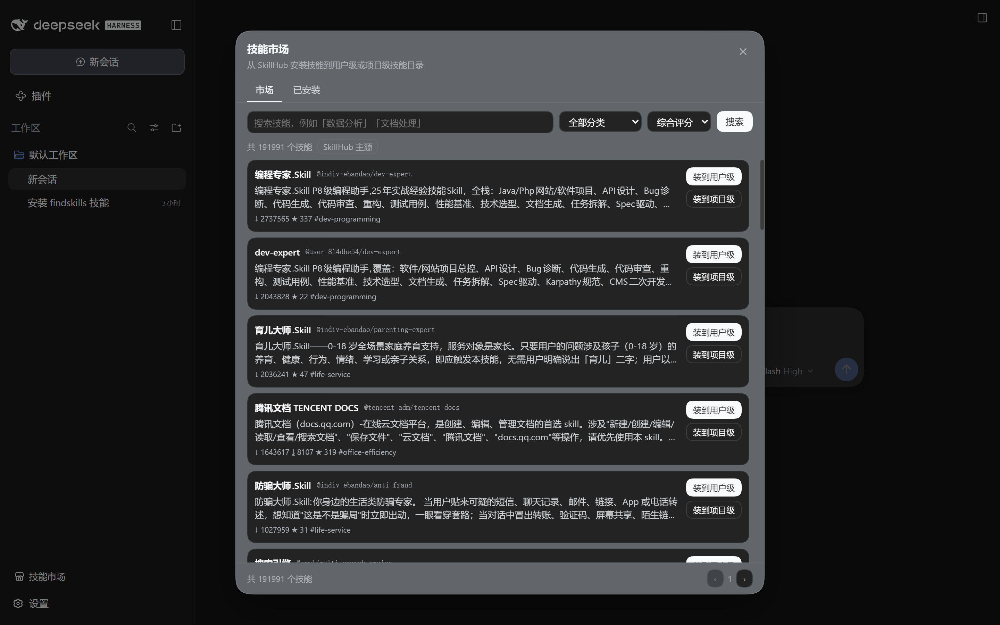
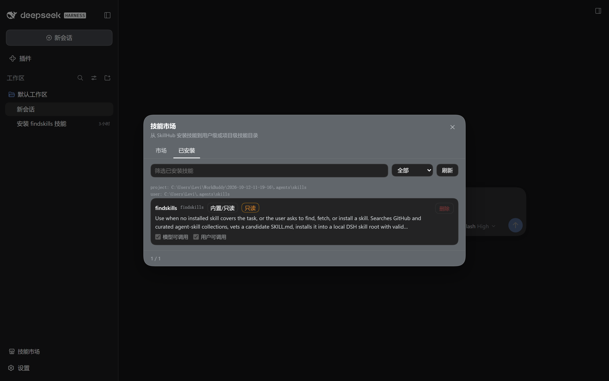
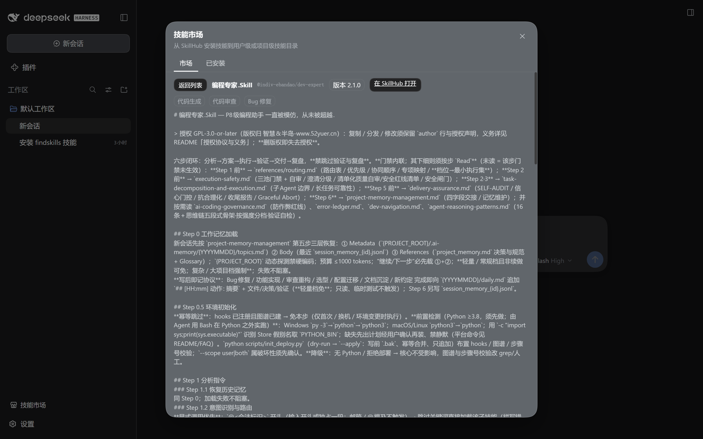
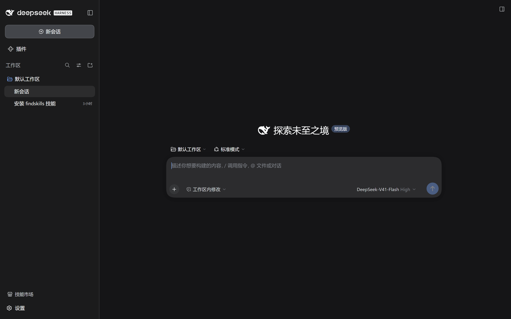

# dsh-skillhub

A DeepSeek Harness (DSH) plugin that puts a **Skill Market** in the Web UI sidebar:
search and browse SkillHub, install skills into user-level or project-level skill
directories with one click, manage what is installed, and give the in-session
agent a read-only market search tool.

Target: **DSH `0.2.0-rc.2`** (Cordis `~4.0.4`).

DSH ships no marketplace of its own — its bundled `findskills` skill discovers
skills from GitHub, driven by the model through shell commands. This plugin is the
SkillHub-backed, user-facing counterpart: a panel instead of a shell loop, and a
registry that is not GitHub. It renders the registry's own records; the skills it
lists under *Installed* are the real files in DSH's four skill roots, several of
which it cannot write to. The comparison is spelled out in
[DEVNOTES §5](./DEVNOTES.md#5-design-decisions-worth-stating).

> **Read [docs/landscape.md](./docs/landscape.md) before judging whether this
> should exist.** A survey of the ecosystem on 2026-10-12 found **21 repositories
> in this exact category** and **199 marketplace-shaped DSH projects** overall,
> against a 6 229-star incumbent in the general case — and, more pointedly, that
> **SkillHub's own vendor ships a DSH plugin**, `@tencent/skillhub` inside
> [`Tencent/skillhub`](https://github.com/Tencent/skillhub), which covers the whole
> original brief and more, including this plugin's sidebar slot. This is one entry
> in a crowded field with a handful of things it does more carefully (§4 of that
> document); it is not a gap being filled.

> **On the name.** The package is `dsh-skillhub`, after the registry it talks to.
> The panel it renders is still labelled *Skill Market* / 技能市场, because that
> is what the surface *is* — a marketplace UI. Package identity and product label
> are named for different things on purpose; the composition row id is
> `skill-hub`.

---

## Preview

Both surfaces, captured from a live `dsh --profile web` session rather than drawn
by hand — the shipped `lib/client.js` is what rendered these
([how to reproduce](./DEVNOTES.md#66-the-rendered-panel)):

**The sidebar entry and the market tab.** Downloads, installs, stars and category
come straight from the SkillHub page that is currently serving the result; the chip
next to the total names that source.



**Installed skills.** Filter text, level bucket, and per-skill switches for model
invocation and user invocation. Built-in roots are shown but marked read-only, and
the promote action only appears for project-level skills.



**Skill detail.** The SKILL.md body with frontmatter stripped, plus tags, version,
and a link back to the SkillHub page.





---

## Install

From GitHub:

```bash
dsh plugin --profile <profile> add github:K1yomizu/dsh-skillhub
```

`dsh plugin` forwards its arguments straight to pnpm, so this is an ordinary
`github:` specifier. It works **because `lib/` is committed**: pnpm builds a git
dependency only when it declares a `prepare` script, and this package deliberately
has none, so the prebuilt artifacts in the repo are what gets installed. Check out
the tag matching the DSH release you are running.

From a local checkout:

```bash
dsh plugin --profile <profile> add "file:/abs/path/to/dsh-skillhub"
```

Prefer the explicit `file:` prefix over a bare path: a bare path makes pnpm
resolve the dependency through the `link:` protocol, and pnpm `12.5.1` writes the
entry to `package.json` without ever creating `node_modules/<pkg>`, so the
installer's manifest resolution step fails afterwards. This is a pnpm bug, not a
plugin one — see [DEVNOTES](./DEVNOTES.md#pnpm-link-protocol). Always run
`npm run build` first so `lib/` exists; `lib/` is what ships.

Either way the installer links the package into `$DSH_HOME/profiles/<profile>` and
appends it to `dsh.profile.bundles`, which is what makes its `cordis.patch.yml`
layer get composed into the boot tree. Restart the profile afterwards.

### The reserved `desktop` profile

DeepSeek Harness Desktop owns the profile named `desktop`, and the CLI refuses it
by design — `lib/bin.js` contains a hard-coded
`if (profile === "desktop") program.error("profile \"desktop\" is managed exclusively by the Electron application")`.

The sanctioned path is the same entry point the application itself calls: `runCli`
takes a `manageDesktopProfile` argument (documented as *"permit Desktop's installed
carrier to manage its reserved profile's plugins"*) which the shell front-end only
passes when the app invokes it. `scripts/desktop-profile.mjs` calls it directly, so
the profile lock, the compatibility preflight, the `package.json`/`pnpm-lock.yaml`
rollback snapshot, and the bundle reconcile all still run:

```bash
DSH_INSTALL=/path/to/node_modules/@deepseek-ai/dsh \
  node scripts/desktop-profile.mjs add "file:/abs/path/to/dsh-skillhub"
```

Quit the desktop application first — the installer takes a lock on the profile and
the app must re-read it on its next start.

---

## Features

### 1. Search and browse, with automatic source fallback

The panel's **Market** tab queries SkillHub and degrades through a three-step
chain, recording every attempt so the UI can say *what* degraded rather than
silently showing stale data:

| # | Source | Host |
|---|--------|------|
| 1 | `skillhub` | `https://api.skillhub.cn` |
| 2 | `skillhub-mirror` | `https://api.skillhub.tencent.com` |
| 3 | `local` | the skills already installed on this machine, keyword-filtered |

Filter by category (the live category table, or a built-in 12-entry table when
both hosts are unreachable), sort by score / downloads / stars / last update, and
page through results.

All upstream traffic is proxied by the Host half. This is required, not a
preference: no SkillHub endpoint sends CORS headers, so the browser cannot reach
it directly.

### 2. One-click install and uninstall — user level or project level

Install writes into the same directories DSH itself reads:

| rank | root | path | writable by this plugin |
|------|------|------|--------------------------|
| 100 | `project-dsh` | `<projectRoot>/.dsh/skills` | read-only |
| 200 | `project-agents` | `<projectRoot>/.agents/skills` | **yes** — project level |
| 400 | `user-dsh` | `$DSH_HOME/skills` (`~/.dsh/skills`, `.system` skipped) | read-only |
| 500 | `user-agents` | `$DSH_AGENTS_HOME/skills` (`~/.agents/skills`) | **yes** — user level |

`projectRoot` is the nearest ancestor of the working directory containing `.git`,
falling back to the working directory — the same walk DSH performs. The `.dsh`
roots belong to DSH and are surfaced as read-only rows, so the panel shows the
whole picture without touching what it does not own.

**Installs are verified, not blind.** The manifest is fetched once, then every
file is downloaded at the **pinned version** the manifest reported and checked
against its `sha256` before anything is written:

- the version is threaded through every file request, because omitting it makes
  the upstream silently serve the *latest* revision and mix revisions inside one
  skill directory — the upstream trap documented in DEVNOTES;
- writes are staged into a sibling `.staging-*` directory and renamed into place,
  so an interrupted install never leaves a half-written skill;
- a 64 MiB / 600 file ceiling plus `assertSafeRelativePath` bound what a hostile
  or broken manifest can do to the filesystem.

For the same reason it is file-by-file rather than a zip download from
`/download`: per-file `sha256` from the manifest is the only integrity signal
SkillHub offers, and taking it also avoids a zip dependency.

**And the skill is read back before the install is called a success.** Integrity
is not loadability: SkillHub does not validate `name` grammar, so a skill can
download perfectly, verify perfectly, and still be dropped by DSH on the next
scan — with nothing but a `logger.warn` nobody reads. After the rename lands,
the installed `SKILL.md` is parsed again with DSH's own rules and any violation
is returned in the install result and shown as a warning in the panel:

```
已安装「Self-Improving + Proactive Agent」，但 DSH 会忽略它：
name「Self-Improving + Proactive Agent」不符合 DSH 语法（只允许小写字母、数字、连字符）
```

Roughly one in ten of SkillHub's most-downloaded skills trips this. The author's
frontmatter is never rewritten — the plugin reports, it does not edit someone
else's metadata. The rules and their provenance are in
[DEVNOTES §6.7](./DEVNOTES.md#67-the-post-install-read-back).

### 3. Installed-skill management

The **Installed** tab lists every skill across all four roots with:

- **filter** by text and by level (all / project / user / built-in);
- **enable / disable** both invocation surfaces — `disable-model-invocation` and
  `user-invocable` (both default to enabled, so enabling *removes* the key from
  the frontmatter rather than writing `false`);
- **delete** a skill (behind a confirmation);
- **promote project → user**, moving the skill to the user-level root;
- a **read-only** marker on roots this plugin will not modify.

Each mutation is optimistic: the row updates immediately and, if the API rejects
it, the panel re-reads the directory and reports the real state rather than
leaving a lie on screen.

### 4. `dsh_skillhub_search` model tool

Registered on the `tools` service so the agent can answer "is there a skill for
X?" and then point the user at the install button. It searches the same market
through the same fallback chain and returns name, `@namespace/slug`, category,
download/install counts, summary and page link.

It is **strictly read-only**: it never installs, deletes or writes anything.
Installation stays a user decision made in the panel, and the rendered result
says so explicitly instead of letting the model imply otherwise.

---

## Configuration

The plugin row is `skill-hub` in its own `cordis.patch.yml`, so it can be
overridden by id from the profile's patch layer:

```yaml
# $DSH_HOME/profiles/web/cordis.patch.yml
- id: skill-hub
  name: dsh-skillhub
  config:
    defaultLevel: project
    pageSize: 50
```

| key | type | default | meaning |
|-----|------|---------|---------|
| `timeoutMs` | number | `15000` | upstream request timeout (1000–120000) |
| `defaultLevel` | `user` \| `project` | `user` | level pre-selected by the install action |
| `pageSize` | number | `30` | rows per market page (1–100) |
| `enableModelTool` | boolean | `true` | register `dsh_skillhub_search` |

---

## UI surfaces

Both are root-scoped `list` slots, so the panel contributes cells beside the
shipped occupants instead of replacing them.

| slot | occupant | notes |
|------|----------|-------|
| `sidebar.footer.action` | the storefront button | owner share `{ wide: boolean }`; `order: -40` |
| `shell.overlay` | the panel | the layer is click-through by contract, so the occupant opts back into pointer events |

The `order: -40` on the footer button is deliberate: the host's own Cordis Plugin
row sits at `0` with an upward-expanding popover, so anything ordered after it
would end up underneath that popover.

---

## How this plugin is packaged

Dual-face, the standard DSH shape:

```
package.json
  main / exports["."]        -> lib/index.js    Host half (ESM, Node)
  exports["./client"]        -> lib/client.js   Browser half (lazy CJS factory)
  dsh.bundle.patch           -> cordis.patch.yml
  dsh.client.platform        -> "web"
  dsh.client.inject          -> the client plugins that declare the two slots
```

- **Host half** (`lib/index.js`) mounts the JSON API route on `webServer` and
  registers the model tool. Only `webServer` gates activation; `tools` is
  attached through a deferred `ctx.inject(['tools'])`, so a profile without the
  tools service still gets a working panel instead of a plugin that fails to
  activate.
- **Browser half** (`lib/client.js`) is wrapped in the loader's lazy factory —
  `window.__ModuleLoader__.load({ id, factory(require) { … } })` — with `id`
  equal to the package name. `react` and `react/jsx-runtime` stay external
  because the shell seeds them into the browser module table; bundling them would
  create a second React instance and break hooks.
- `dsh.client.inject` names `@deepseek-ai/dsh-client-ui-renderer`,
  `-sidebar` and `-layout`: the packages that provide the `slots` service and
  declare the two slots, so they are loaded first.

### Panel API

Same-origin `POST` + `application/json` under
`/plugins/dsh-skillhub/api`, served on the composition's `webServer`
(`WebRoute { kind: 'prefix' }`). A plugin-owned route prefix is the supported
channel for out-of-tree plugins — the Remote surface is a closed set that cannot
be extended from outside.

`/search` `/categories` `/installed` `/install` `/uninstall` `/promote`
`/set-invocation` `/detail`

Why `POST` + JSON for everything, including reads: a cross-site request cannot
reach these routes without a CORS preflight, which the server never answers, and
a mismatched `Origin` header is rejected outright. Handlers never throw across
the boundary — failures come back as `{ ok: false, error, kind? }`.

---

## Development

```bash
npm install --legacy-peer-deps   # peer conflicts in the published tree
npm run typecheck                # tsc --noEmit
npm run build                    # esbuild -> lib/index.js + lib/client.js
npm test                         # contract rules, 28 cases (hermetic)
npm run verify                   # typecheck + test + build (hermetic)
npm run test:readback            # install a real skill, assert the read-back (needs network)
npm run smoke                    # Host half against the live SkillHub API
npm run verify:live              # verify + readback + smoke
npm run capture -- --url "…"     # photograph the panel in a running profile
npm run audit                    # sample SkillHub against DSH's frontmatter rules
```

### Is a SkillHub skill the same thing DSH reads?

Same file format, **different contract** — and it matters, because DSH drops a
malformed skill silently. Sampling the top 30 registry skills
(`npm run audit`):

| | |
|---|---|
| loads cleanly in DSH | 27 / 30 |
| dropped | 3 / 30 — every one a `name` DSH refuses (`Mysteel_PriceSearch`, `全国电子印章互认平台`, `Self-Improving + Proactive Agent`) |
| carry `disable-model-invocation` / `user-invocable` | 1 / 30 |

DSH requires `name` + `description` and enforces a kebab-case `name`; it ignores
the registry's own fields (`version`, `author`, `license`, `slug`, `displayName`,
`xiaping_*`) and treats the camelCase invocation aliases as a hard error. When the
invocation keys are absent DSH defaults both to on, which is why the panel gives
you switches for them.

That is the gap the post-install read-back closes: the three rows above install
successfully and then do not exist as far as the model is concerned. `npm test`
pins the rules against 28 cases and `npm run test:readback` proves they fire on a
real install of a real failing skill.

`npm run smoke` loads the built `lib/index.js` into a real Cordis context, mounts
its route on a stand-in `webServer`, and drives the routes over loopback against
the live upstream — asserting the envelope, the source fallback, the version pin
on `/detail`, and every request guard (method, origin, media type, unknown path,
invalid level, path traversal). It needs network access, which is why it is not
part of `verify`.

It is worth running: the first pass failed 3 of 22 checks and exposed a real bug —
the route was aborting its own upstream calls, because `req`'s `close` event also
fires when a request has merely been consumed, not only when the client leaves.
The fix watches `res` and tests `writableEnded`. Nothing in the type checker, the
build, or the composition dump would have caught it. See
[DEVNOTES §6.2](./DEVNOTES.md#62-host-half-live).

`scripts/build.mjs` asserts the artifacts rather than trusting them: the Host
bundle must export, carry the plugin id and the tool name; the Client bundle must
start with the factory banner, register under the package name, and contain no
residual ESM `react` import. It also validates the manifest — `dsh.bundle.patch`,
`dsh.client`, the `./client` export, and that `files[]` actually ships `lib/` and
`cordis.patch.yml`, the classic packaging omission that links a package without
ever mounting a row.

`scripts/capture-ui.mjs` is the only check that exercises the browser half for
real. Point it at a running `dsh --profile web` URL and a Chromium started with
`--remote-debugging-port`, and it drives the page over the DevTools protocol:
waits for `.smk-entry`, dismisses the first-run notice, clicks through the entry,
the market tab, the installed tab and a detail view, and writes the four shots in
`docs/preview/`. It needs no dependencies — Node 22 provides `fetch` and a global
`WebSocket`. See [DEVNOTES §6.6](./DEVNOTES.md#66-the-rendered-panel).

## Layout

```
src/shared/   types.ts    wire contracts (both halves)
              skillhub.ts SkillHub API client, fetch-injected
src/host/     index.ts    plugin entry, config schema
              api.ts      same-origin JSON routes
              market.ts   source fallback + download/verify/install pipeline
              contract.ts post-install read-back against DSH's load rules
              local.ts    skill roots, frontmatter, atomic writes
              tool.ts     dsh_skillhub_search
src/client/   index.tsx   registration into the two slots
              panel.tsx   the panel UI
              entry.tsx   the sidebar button
              store.ts    framework-free observable store
              api.ts      typed client for the Host routes
              i18n.ts     zh/en copy
              styles.ts   theme-token CSS
              slot-map.d.ts  the two SlotMap entries
scripts/      build.mjs     dual-artifact build + manifest assertions
              test-contract.mjs       the read-back rules, 28 cases
              test-install-readback.mjs  real install, real read-back
              smoke-host.mjs  Host-half integration test
              capture-ui.mjs  browser capture of the rendered panel
              audit-compat.mjs  samples SkillHub against DSH's frontmatter rules
              desktop-profile.mjs  plugin install into the reserved desktop profile
              dump-desktop.mjs     composed-tree dump for that profile
docs/preview/ the four shots in this README, captured from a live session
```

## License

MIT — see [LICENSE](./LICENSE).

See [DEVNOTES](./DEVNOTES.md) for the official-source citations, the live API
probe transcript, the TypeScript traps this plugin had to work around, and the
verification record.
